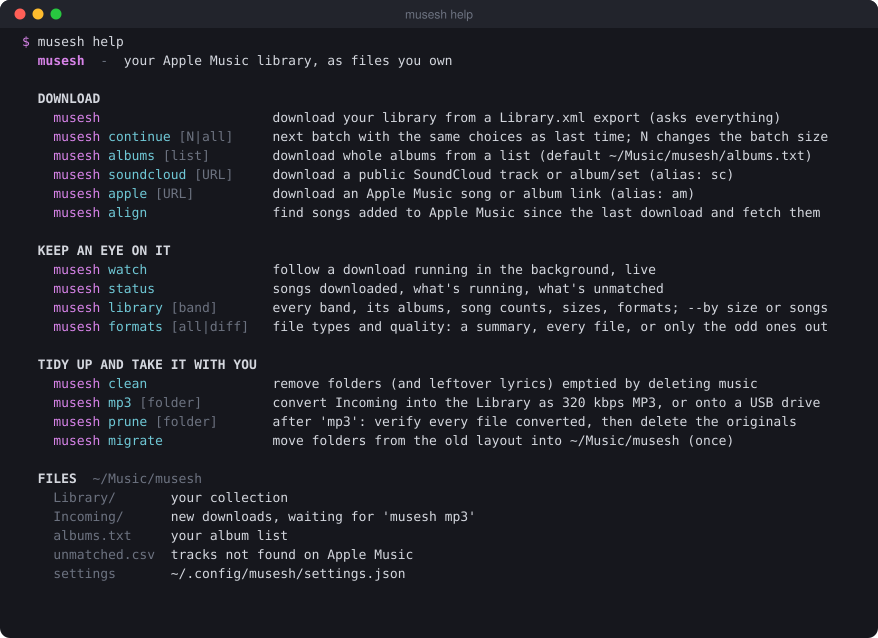
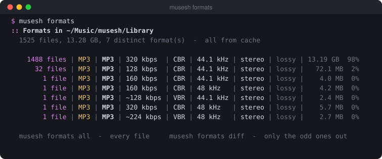

<div align="center">


# musesh

**Your music library, as files you own.**<br/>
Download from Apple Music and SoundCloud. Keep native audio or make an MP3 copy.

[](docs/setup.md)
[](docs/setup.md)
[](https://github.com/glomatico/gamdl)
[](https://github.com/yt-dlp/yt-dlp)

[Setup](docs/setup.md) · [Commands](docs/commands.md) · [How it works](docs/how-it-works.md) · [Troubleshooting](docs/troubleshooting.md)

<br/>



</div>

## Install

```sh
brew install pipx ffmpeg yt-dlp
pipx install gamdl
git clone https://github.com/Comiclyy/musesh.git ~/code/musesh
mkdir -p ~/bin
ln -s ~/code/musesh/musesh ~/bin/musesh
```

Keep `~/bin` on your PATH. See [Setup](docs/setup.md) for cookies and library exports.

## Use

```sh
musesh am "APPLE_MUSIC_URL"  # song or album; alias: apple
musesh sc "SOUNDCLOUD_URL"   # track or album/set; alias: soundcloud
musesh                     # download a Library.xml export
musesh continue            # next library batch
musesh align               # fetch newly added Apple Music songs
musesh mp3                 # MP3 copy to Library or USB
```

Replace the URL placeholders with share links, or omit them to be prompted.
Apple Music needs a subscription and [cookies](docs/setup.md#apple-music-cookies).
Public SoundCloud links need no login; optional cookies use your account's access.
Preview-only tracks are skipped.

Downloads land in `~/Music/musesh/Incoming`, organized by artist and album.
Finished tracks are remembered. `musesh mp3` keeps tags, artwork and native sources.

## Manage your collection

| Command | Does |
| --- | --- |
| `musesh albums [list]` | Download Apple Music albums from a text list |
| `musesh library` | Browse artists, albums and file sizes |
| `musesh formats` | Inspect codecs and audio quality |
| `musesh watch` / `status` | Follow downloads and check progress |
| `musesh clean` | Remove empty folders and orphaned lyrics |
| `musesh prune` | Verify MP3 copies, then offer to delete originals |



Run `musesh help` for all commands, or read the [command reference](docs/commands.md).
