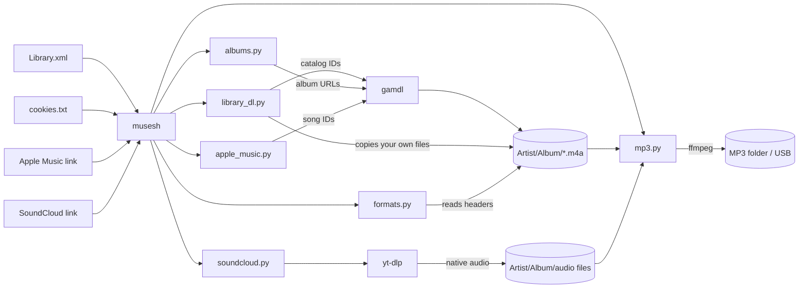

# How it works

The CLI delegates to a small set of helpers:

1. **`musesh`**: the CLI. Menus, prompts, remembered choices. Standard-library
   Python, so it starts instantly; it hands heavy work to the scripts below.
2. **`library_dl.py`**: downloads a library from a `Library.xml` export.
3. **`albums.py`**: resolves and downloads album lists.
4. **`formats.py`**: the format report.
5. **`library.py`**: the library tree (bands, albums, counts, sizes).
6. **`mp3.py`**: the MP3 mirror and `prune`.
7. **`apple_music.py`**: direct Apple Music song and album links.
8. **`soundcloud.py`**: public SoundCloud track and album/set links.
9. **`transfer.py`**: prepares MP3 batches and publishes them to a Windows share.
10. **`music_dates.py`**: persists local addition dates through imports and conversion.
11. **`push.py`**: previews and copies recent Library MP3s to a mounted Walkman,
    remembering handled and excluded songs independently of what remains on it.
12. **`eject.py`**: shares the push lock, requests normal macOS ejection, and
    verifies the mount is gone before reporting safe removal.

The Apple Music, format, library and MP3 helpers run with the Python inside
gamdl's pipx environment, which has gamdl, `httpx` and `mutagen`. SoundCloud
uses standard-library Python and a separate yt-dlp executable, preferring
Homebrew over PATH. Styling is shared through `ui.py`.

## Matching songs to Apple Music

A `Library.xml` export lists your songs by name, artist, album and length, but
not by their Apple Music catalog ID, which is what gamdl needs. musesh finds
the ID in two steps:

1. **Your cloud library.** With your cookies, musesh asks Apple Music for your
   own library (about 100 songs per request), which does carry catalog IDs. A
   song matches when the title and artist match (normalised: case, accents and
   punctuation ignored) and the length is within a few seconds. This places the
   large majority of songs exactly, in a couple of minutes.
2. **Catalog search**, only for what's left: songs whose details changed since
   you added them, re-released albums, or uploads. Candidates are scored on
   title, artist, album and length, and only a confident match is accepted.
   The public iTunes search API is used, paced at about one request every
   3 seconds and backing off when Apple says "too many requests".

Anything still unmatched goes to `unmatched.csv`. Nothing is guessed.

If a song's ID turns out to be dead (Apple answers 404, usually because the
album was re-released under a new ID), the ID is recorded in `gone.txt` and the
song is searched again, instead of counting as a failure.

## Apple Music library batches, resuming and failures

- Finished songs are appended to `done.txt` as they complete, so any run can
  be stopped and resumed.
- A song that fails is retried in the next batch; after **2 failures** it's
  set aside (listed in `failures.json`) so it can't block the queue.
- If **5 songs in a row** fail, the run stops and blames the most likely cause,
  expired cookies, without counting those 5 against their retry limit.
- The login is checked before anything else. A cookies file that's missing,
  malformed, logged out or expired stops with a plain-English reason.

## What `align` considers new

Every song in an Apple Music library has a permanent **Persistent ID** that
appears in each export. `align` keeps every ID it has seen in `seen.json`:

- The first run records every ID in the export the library was downloaded
  from, as "already handled".
- After that, only IDs it has never seen are offered.

Deleting a file from the folder doesn't remove its ID from `seen.json`, which
is why deleted songs never come back. Songs you choose are downloaded from a
small export containing only them, so nothing else in the folder is touched
(the full downloader would otherwise re-copy your own files that you had
deleted). They're only marked as handled once their download finishes.

## Album lists

Each `Artist - Album` line is resolved **artist first**: find the artist
(exact-name matches win, and "&" equals "and"), then pick the album from that
artist's own catalog. That avoids same-named albums by other acts. When several
editions exist, the plain one wins over *Deluxe*, *Remastered* or *Expanded*,
then the one with the fewest tracks.

`Artist - *` uses Apple Music's own **Albums** section for the artist, which
leaves out live albums, compilations and box sets. `+eps` adds EPs from the
**Singles & EPs** section.

Album lists also accept Apple Music playlist URLs. `albums.py` resolves the
playlist through the authenticated API and passes its URL to gamdl; the entire
playlist is selected, including tracks by different artists. This support is
in `albums`, not the direct `apple` / `am` command.

## Direct Apple Music links

Direct Apple Music links (`apple` / `am`) use `apple_music.py` in gamdl's Python
environment. Song links are normalized to catalog IDs; album links expand to
individual songs through the authenticated catalog API, including paginated
track lists. They share `done.txt` with library downloads, and record an album
as complete only when all of its songs have finished. Their native audio is
downloaded through the same gamdl runner as the Library.xml workflow.

## SoundCloud links

SoundCloud runs through the independent standard-library `soundcloud.py`
helper and the `yt-dlp` executable (Homebrew first, then PATH). It stages downloads and metadata
processing inside `Incoming/.musesh/soundcloud-work/`, verifies an audio stream
with ffprobe, then publishes the finished file without overwriting existing
music. Completion is recorded by SoundCloud track ID, separately from Apple
Music, only after publication succeeds. Preview formats are excluded.

Optional cookies are passed to both metadata lookup and downloading. Browser
cookies are read locally; file exports are copied into a private temporary
directory and removed after the command, leaving the export unchanged.
Neither cookie contents nor SoundCloud login preferences enter settings.
Unfinished work stays under `.musesh/soundcloud-work/` for retries; the
working directory is private because metadata can include signed media URLs.

Each successful track ID is kept in `soundcloud-done.json`, even after its
file is deleted. Repeating a link resumes unfinished tracks and skips completed
ones across sets. There is no automatic SoundCloud feed or profile sync.

## Formats

`formats.py` reads only each file's header with `mutagen` (under a
millisecond per file), on several threads, and caches the results by path,
modification time and size. A first scan of ~1,500 files takes about a
second; repeats take a tenth of that.

## The MP3 mirror

For every song in the library, `mp3.py` decides what to do before starting,
by reading headers in the MP3 folder: skip it (already a 320 kbps MP3 of the
right length), convert it, redo it (wrong bitrate or cut short), or copy it
(already an MP3 in your library). Conversions run in parallel with ffmpeg
(`libmp3lame`, 320 kbps CBR, tags and cover art carried over), writing to a
`.part.mp3` file that's renamed into place only when complete.

`prune` goes further than a header check: it decodes every MP3 end to end,
which catches corruption that a correct-looking header would hide.

## Files on disk

The optional [Windows transfer](windows-transfer.md) publishes immutable batches
with SHA-256 manifests by renaming a completed staging directory. Its PowerShell
launcher identifies the configured player independently of its drive letter,
verifies each copied file, and writes a receipt per success. Mac preparation
deduplicates against both receipts and already queued batches. A Mac-side file
lock and a Windows-side exclusive file lock prevent concurrent runs on each side.

| Path | Holds |
| --- | --- |
| `~/.config/musesh/settings.json` | Saved choices: export, cookies, Incoming and Library folders, batch size |
| `~/.cache/musesh/formats.json` | Format scan cache |
| `~/.cache/musesh/library.json` | Tag cache for `musesh library` |
| `Incoming/.musesh/matches.json` | Persistent ID to catalog ID (`""` = not in the catalog) |
| `Incoming/.musesh/done.txt` | Song and album URLs that finished |
| `Incoming/.musesh/failures.json` | Failure count per URL |
| `Incoming/.musesh/gone.txt` | Catalog IDs Apple answers with 404 |
| `Incoming/.musesh/seen.json` | Every Persistent ID `align` has seen |
| `Incoming/.musesh/albums.json` | Cached album-list lookups |
| `Incoming/.musesh/*.log` | Logs of background runs (`musesh watch` follows these) |
| `Incoming/.musesh/apple-run.log` | Direct Apple Music link progress (`musesh watch` follows this too) |
| `Incoming/.musesh/soundcloud-done.json` | Finished SoundCloud track IDs and relative file paths, retained after deletion |
| `Incoming/.musesh/soundcloud-run.log` | SoundCloud progress and errors (`musesh watch` follows this too) |
| `Incoming/.musesh/soundcloud-work/` | Staged and interrupted SoundCloud downloads, excluded from library scans |
| `~/Music/musesh/unmatched.csv` | Tracks that couldn't be found on Apple Music |
| `Library/.musesh/pruned-originals.txt` | MP3s whose original was pruned |
| `<music folder>/.musesh/added.sqlite3` | Persistent local addition dates |
| `~/Music/musesh/.transfer/` | Windows handoff settings, native-to-MP3 cache, pending batches |
| `~/Music/musesh/.push/` | Player identity and direct-push history, including excluded and pending songs |
| `<Windows share>/batches/` | Complete prepared batches and hidden unfinished uploads |
| `<Windows share>/receipts/` | Successful uploads, one receipt per song version |
